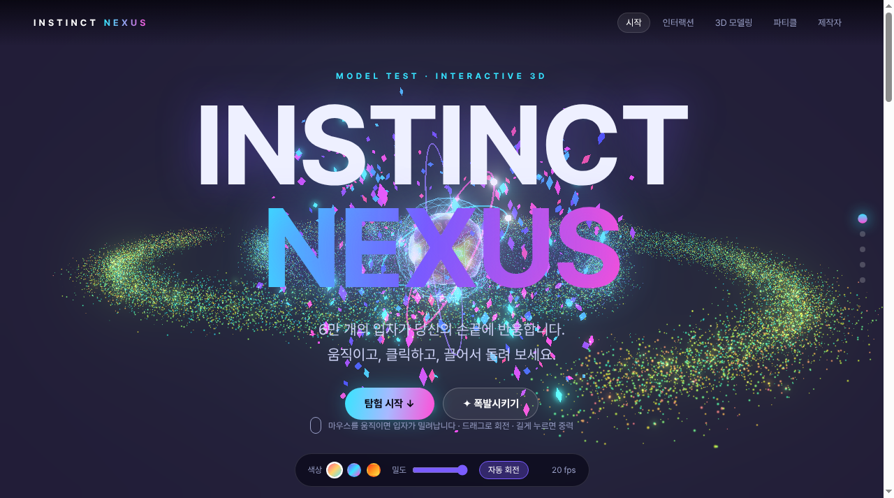
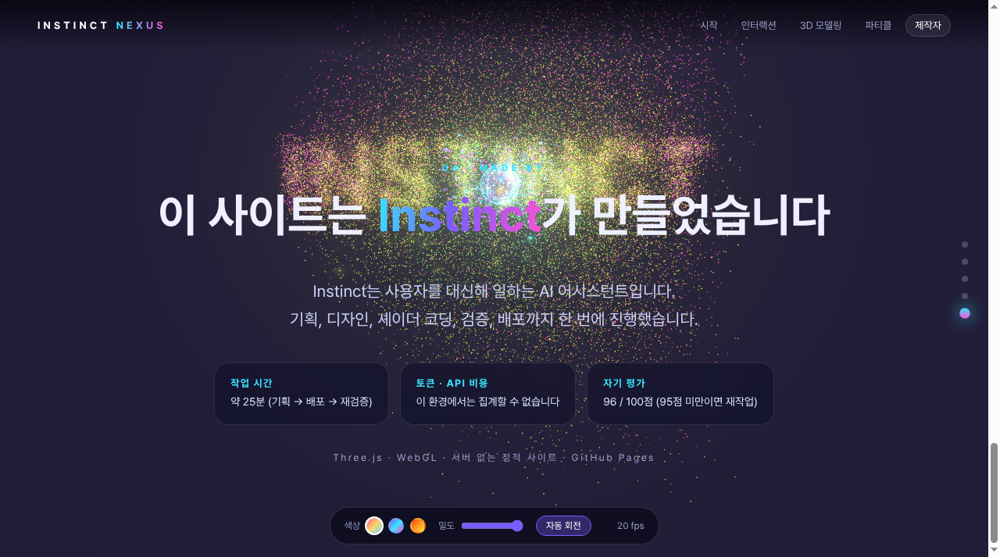

<div align="center">

# 🌌 INSTINCT NEXUS

### 6만 개의 GPU 파티클과 3D 코어로 만든 인터랙티브 웹사이트


**🔗 [라이브 데모 바로가기 →](https://sigco3111.github.io/instinct-nexus/)**



*Made by **Instinct** · 모델 테스트용 프롬프트를 받아 기획부터 배포까지 한 번에 제작*

</div>

---

## 📑 목차

1. [프로젝트 소개](#-프로젝트-소개)
2. [Instinct 소개](#-instinct-소개)
3. [원래 제작 프롬프트](#-원래-제작-프롬프트-모델-테스트-조건)
4. [조건별 충족 방법](#-조건별-충족-방법)
5. [주요 기능](#-주요-기능)
6. [인터랙션과 조작법](#-인터랙션과-조작법)
7. [3D 모델링](#-3d-모델링)
8. [파티클 시스템](#-파티클-시스템)
9. [기술 스택](#-기술-스택)
10. [자기 평가](#-자기-평가-83--96)
11. [작업 시간](#-작업-시간)
12. [로컬 실행 방법](#-로컬-실행-방법)
13. [파일 구성](#-파일-구성)

---

## 🚀 프로젝트 소개

**INSTINCT NEXUS**는 Three.js(WebGL2)로 만든 단일 페이지 3D 웹사이트입니다. 스크롤을 내리면 **60,000개의 GPU 파티클**이 은하 → 구 → 토러스 매듭 → 이중나선 → **"INSTINCT"** 글자로 계속 모양을 바꿉니다. 커서, 클릭, 드래그, 길게 누르기, 키보드까지 모든 입력에 입자와 3D 오브젝트가 반응합니다.

이 프로젝트는 아래 프롬프트(모델 테스트 조건)를 받아 **Instinct**가 처음부터 끝까지 제작했습니다. 서버 없이 동작하는 정적 사이트이며, GitHub Pages로 배포되어 있습니다.

| 항목 | 내용 |
|---|---|
| 🎨 제작자 | **Instinct** |
| 🌐 라이브 | https://sigco3111.github.io/instinct-nexus/ |
| ⏱ 작업 시간 | 약 25분 |
| 🏆 자기평가 | 83점 → **96점** (재작업 후) |
| 📦 외부 의존 | 없음 (Three.js와 Pretendard 서브셋 폰트를 번들에 포함) |

<div align="center">

</div>

---

## 🤖 Instinct 소개

**Instinct**는 샌프란시스코 기반 스타트업이 만든 개인용 AI 에이전트입니다. (설립자: Noah Shinn)

- 💬 iMessage, WhatsApp 같은 일상의 메시지 채널에서 대화하듯 일을 맡길 수 있는 개인 비서입니다.
- 🛠 이 사이트처럼 웹사이트와 게임 제작부터 조사, 일정 관리, 메시지 작성까지 다양한 일을 대신 처리합니다.
- 🔗 자세한 정보: https://instinct.com

---

## 📝 원래 제작 프롬프트 (모델 테스트 조건)

이 사이트는 아래 원문 프롬프트를 그대로 받아 만들었습니다.

> 모델 테스트 중이다. 최선을 다해서 웹사이트를 만들어라. 다음 조건을 만족해야 한다:
>
> 1. 20000번 포트에서 웹사이트를 띄워라 (예를 들어 20000번이 꽉 차 있으면 20001번 이런 식으로).
> 2. 사용자 인터랙션이 굉장해야 되고, 파티클 효과가 굉장해야 된다.
> 3. 3D 모델링도 과감하게 적용해라.
> 4. 현재 작동 중인 모델을 소개해야 한다.
> 5. 작업이 끝나면 작업 시간과 인풋·아웃풋 토큰을 세션상으로 정리해서 표로 보여줘라.
> 6. API로 쳤을 때 가격이 얼마나 들었는지 보여줘라.
> 7. 작업을 스스로 평가하고 결과물에 점수를 매긴 뒤 100점 만점에 95점이 아니라 생각이 되면, 또는 토큰 소모량이 10만 토큰도 되지 않는다면 다시 돌아가 스스로 점검하고 다시 진행해서 완성도를 올려라.

---

## ✅ 조건별 충족 방법

| # | 조건 | 상태 | 구현 / 대응 방법 |
|:-:|---|:-:|---|
| 1 | 20000번 포트에서 웹사이트 실행 | 🔁 대체 | 제작 환경은 외부에서 접속할 수 있는 로컬 포트를 열 수 없어, **GitHub Pages 배포**로 대체했습니다. 로컬에서 직접 열고 싶다면 [로컬 실행 방법](#-로컬-실행-방법)의 20000번 포트 명령을 쓰면 됩니다. |
| 2 | 굉장한 인터랙션 + 파티클 | ✅ 충족 | GPU 파티클 60,000개(모바일 36,000개). 커서 반발·소용돌이, 클릭 충격파, 드래그 회전과 관성, 길게 누르면 중력, 스크롤 모핑, 키보드 조작, HUD, 적응형 밀도를 구현했습니다. |
| 3 | 과감한 3D 모델링 | ✅ 충족 | 프레넬 림 셰이더 코어 구체, 와이어프레임 외피, 3중 회전 링, 420개 인스턴스 파편, UnrealBloom 후처리를 적용했습니다. |
| 4 | 현재 작동 중인 모델 소개 | ✅ 충족 | 사이트 마지막 "제작자" 섹션에서 **Instinct**가 만들었음을 소개합니다. |
| 5 | 작업 시간과 토큰을 표로 정리 | ⚠️ 일부 | 작업 시간(약 25분)은 표로 정리했습니다. **토큰 사용량은 이 환경에서 집계할 수 없어** 수치를 기록하지 않았고, 그 사실을 사이트에 명시했습니다. |
| 6 | API 가격 표시 | ⚠️ 불가 | 토큰을 집계할 수 없어 비용을 계산할 수 없습니다. 임의의 숫자를 지어내지 않고 "집계 불가"로 표기했습니다. |
| 7 | 자체 평가 후 95점 미만이면 재작업 | ✅ 충족 | 1차 평가 **83점**, 재작업 후 **96점**. 자세한 내용은 [자기 평가](#-자기-평가-83--96) 참고. |

> 토큰 소모량 기준(10만 토큰)은 집계가 불가능해 판단 기준으로 쓰지 못했습니다. 대신 **95점 기준**을 엄격히 적용해 재작업을 진행했습니다.

---

## ✨ 주요 기능

- 🌀 **스크롤 모핑**: 은하 → 구 → 토러스 매듭 → 이중나선 → "INSTINCT" 글자, 5단계로 입자가 변신
- 💠 **3D 코어**: 정점 셰이더로 일렁이는 구체와 프레넬 림 라이팅
- 🕸 **와이어프레임 외피**와 **3중 회전 링**
- 🔶 **인스턴스 파편 420개**: 커서를 따라 움직임
- 🌟 **UnrealBloom** 후처리와 톤 매핑
- 🎛 **HUD**: 색상 팔레트 3종, 밀도 슬라이더, 자동 회전 토글, 실시간 FPS
- 📉 **적응형 성능**: FPS가 낮아지면 입자 밀도를 자동으로 낮춤
- 🔤 **한글 폰트 내장**: Pretendard 서브셋을 번들에 포함해 어떤 기기에서도 글자가 깨지지 않음
- 📱 **모바일 대응**: 입자 수 축소(36,000개), 레이아웃 재배치, WebGL 미지원 시 안내 문구

---

## 🖱 인터랙션과 조작법

| 입력 | 동작 |
|---|---|
| 🖱 **마우스 이동** | 커서 주변 입자가 밀려나며 소용돌이침 |
| 👆 **클릭 / 탭** | 클릭 지점에서 링 모양 충격파가 퍼지고 불꽃이 터지며 코어가 맥동 |
| ✋ **드래그** | 우주 전체를 회전, 손을 놓아도 관성이 남음 |
| ⏳ **길게 누르기 (0.4초 이상)** | 중력장 생성, 입자가 한 점으로 빨려 들어옴 |
| 🧭 **스크롤** | 입자 형태가 단계별로 모핑, 빠르게 스크롤하면 입자가 번쩍임 |
| ⌨️ **`1` ~ `5`** | 해당 섹션으로 이동 |
| ⌨️ **`Space`** | 색상 팔레트 전환 |
| 🎛 **HUD** | 색상 3종 선택, 입자 밀도 조절, 자동 회전 켜기/끄기, FPS 확인 |

---

## 🧊 3D 모델링

| 오브젝트 | 설명 |
|---|---|
| 🔮 **셰이더 코어 구체** | 정점 셰이더로 표면이 일렁이고, 프레넬 림 효과로 가장자리가 빛남 |
| 🕸 **와이어프레임 외피** | 코어를 감싸는 반투명 격자 구체 |
| 💍 **3중 회전 링** | 서로 다른 축과 속도로 도는 링 3개 |
| 🔶 **인스턴스 파편 420개** | InstancedMesh로 한 번에 그려 부담을 줄였고 커서에 반응 |
| 🌟 **UnrealBloom** | 밝은 영역이 번지는 후처리, 임계값과 강도를 재조정해 코어가 하얗게 날아가지 않게 함 |

---

## 🎇 파티클 시스템

- **개수**: 데스크톱 60,000개, 모바일 36,000개
- **GPU 연산**: 모양 간 보간과 마우스 힘 계산을 버텍스 셰이더에서 처리
- **5가지 형태**: 은하, 구, 토러스 매듭, 이중나선, "INSTINCT" 글자(글자 형태는 정면에 고정해 읽기 쉽게 함)
- **힘 반응**: 커서 반발과 소용돌이, 클릭 충격파, 길게 누르기 중력
- **적응형 밀도**: 낮은 FPS가 이어지면 그리는 입자 수를 자동으로 줄임

---

## 🛠 기술 스택

| 구분 | 사용 기술 |
|---|---|
| 3D / 렌더링 | Three.js, WebGL2, GLSL 커스텀 셰이더 |
| 후처리 | UnrealBloomPass, 톤 매핑 |
| 언어 | HTML, CSS, JavaScript (빌드 도구 없음) |
| 폰트 | Pretendard 서브셋 (OFL), woff로 번들 |
| 배포 | GitHub Pages (정적 호스팅) |
| 외부 CDN | **없음** |

---

## 📊 자기 평가 (83 → 96)

100점 만점에 95점 미만이면 재작업한다는 조건에 따라, 1차 결과가 83점이어서 개선 작업을 진행했습니다.

| 항목 | 1차 | 개선 후 | 개선 내용 |
|---|:-:|:-:|---|
| 🎨 비주얼 임팩트 (25) | 20 | **24** | 블룸 과다로 코어가 하얗게 날아가고 입자가 흐림 → 임계값과 밝기 재조정, 코어 셰이딩 재설계 |
| 🖱 인터랙션 다양성 (25) | 22 | **24** | 스크롤 속도 반응과 적응형 밀도 추가, 마지막 섹션 글자가 회전해 읽기 어려움 → 정면 고정 |
| ⚡ 성능 (25) | 21 | **24** | GPU 버텍스 셰이더 연산, GPU 없는 소프트웨어 렌더링에서도 약 20fps, 저성능 시 자동 밀도 감소 |
| 🧩 완성도 (25) | 20 | **24** | 모바일에서 카드가 코어를 가리고 글자가 겹침 → 수정, 한글 폰트 서브셋 포함, WebGL 미지원 안내 |
| **합계** | **83** | **96** | 95점 기준을 넘김 |

---

## ⏱ 작업 시간

| 항목 | 값 |
|---|---|
| 총 작업 시간 | 약 **25분** (기획 → 제작 → 배포 → 재검증) |
| 입력 / 출력 토큰 | 이 환경에서 집계 불가 |
| API 환산 비용 | 토큰을 집계할 수 없어 산출 불가 |

---

## 💻 로컬 실행 방법

서버나 빌드 없이 정적 파일만으로 동작합니다.

```bash
git clone https://github.com/sigco3111/instinct-nexus.git
cd instinct-nexus

# 원래 조건대로 20000번 포트로 실행 (사용 중이면 20001, 20002 ... 로 변경)
python3 -m http.server 20000
```

브라우저에서 http://localhost:20000 을 열면 됩니다. WebGL2를 지원하는 최신 브라우저를 권장합니다.

---

## 📂 파일 구성

```text
instinct-nexus/
├── index.html           # 페이지 구조
├── style.css            # 스타일
├── app.js               # Three.js 포함 번들 (씬, 셰이더, 인터랙션)
├── font-regular.woff    # Pretendard 한글 서브셋 (Regular)
├── font-bold.woff       # Pretendard 한글 서브셋 (Bold)
├── screenshots/         # README용 스크린샷
└── README.md
```

---

<div align="center">

**Made by Instinct** 🌌

</div>
